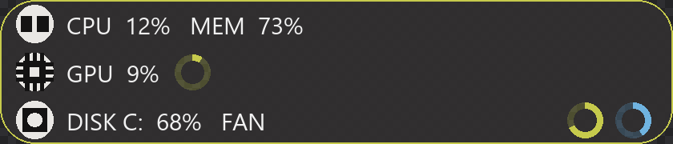

# Endfield Info Windhawk

一个轻量、可配置、**始终置顶**的状态面板，为 [Windhawk](https://windhawk.net/) 编写。
它把 CPU、内存、网络、GPU、时间等数据画成一条圆角面板，常驻在屏幕顶部中央。



> 上图为版面预览。棋盘格用来显示面板的半透明效果。

**它不注入、不挂钩任何进程**：作为 Windhawk 的 **tool mod**，它运行在一个独立的
`windhawk.exe` 进程里，因此不会影响任何其他程序。

---

## 目录

- [安装](#安装)
- [快速上手](#快速上手)
- [面板是永远可以点回来的](#面板是永远可以点回来的)
- [写自己的内容](#写自己的内容)
- [变量速查](#变量速查)
- [数值对齐与格式化](#数值对齐与格式化)
- [环形占用条](#环形占用条)
- [左侧图标](#左侧图标)
- [外观与主题](#外观与主题)
- [入场动画](#入场动画)
- [全部设置项](#全部设置项)
- [资源占用](#资源占用)
- [常见问题](#常见问题)
- [图标/面板看不见或不对时怎么排查](#图标面板看不见或不对时怎么排查)

---

## 安装

1. 安装 [Windhawk](https://windhawk.net/)（1.7.3 或更高）。
2. 打开 Windhawk → **Mods** → **Create new mod**。
3. 把 `endfield-info-windhawk.wh.cpp` 的全部内容粘贴进去，替换掉模板。
4. 点 **Compile mod**，成功后点 **Install**。
5. 打开该 mod 的 **Settings** 页调整内容与外观，保存后立即生效。

面板默认出现在**最上方那台显示器的顶部中央**。

> **第一次看不到面板？** 默认的点击行为是 `Toggle`，而 `Toggle` 模式**启动时是收起的**——
> 它缩成顶部中央一个 **8 像素高**的小标签，中间有一道短横握把。
> 点一下那个小标签就会展开。详见下一节。

---

## 快速上手

最省事的路径：**先别改任何东西，让它跑起来，再逐项调**。

1. 展开面板，确认能看到数字。
2. 到 **Settings** 把 `Row 1` 改成你想要的内容，例如：

   ```
   CPU {cpu|0}%   RAM {mem}%   GPU {gpu|0}%
   ```

3. 保存。面板会立刻更新。
4. 想加环形条就写 `[[ring:{cpu}]]`，想换配色就改 `Theme`。

---

## 面板是永远可以点回来的

收起**不等于隐藏**。收起时面板缩成顶部中央的一个小标签，仍然可见、仍然可以点击。

这一点是刻意的：如果收起等于消失，就没有任何地方能点回来了。

点击做什么由 `What a click does` 决定：

| 设置值 | 点击的效果 |
| :-- | :-- |
| `Proximity` | 在"鼠标靠近自动弹出"和"始终展开"之间切换**显示模式** |
| `Toggle`（默认） | 展开 / 收起。展开后保持常显，再点一次才收起 |

`Proximity` 模式下，鼠标移到最上方显示器**顶部中央**就会自动展开；离开 `Hide delay`
毫秒后自动收起。热区宽度约是屏幕宽度的三分之一。

**边框颜色就是状态指示**：展开时是 `Border` 的颜色，收起时换成 `Collapsed border`
的暗色。不用看文字就能知道当前是哪种状态。

---

## 写自己的内容

最多 **4 行**，每行是一段自由文本，用 `{变量}` 插入实时数据。行留空就不显示，行数决定面板高度。

```
示例 1：CPU {cpu|0}%   RAM {mem}%   GPU {gpu|0}%
示例 2：↓{net.down}  ↑{net.up}   {time}
示例 3：CPU [[ring:{cpu}]]  RAM [[ring:{mem}]]
```

**只写你需要的数据**。没有被任何一行引用到的采集通路不会被加载——这能省下可观的内存，
细节见[资源占用](#资源占用)。

### 一行装不下会怎样

每行都是**一行读数，不会换行**。文字长度超过面板能放下的宽度时，超出的部分会被裁掉，
并在末尾留一个 `…`：

```
CPU 12%  RAM 73%  GPU 33%  NET 1.2 MB/s  DISK 68%…     （面板放不下时）
```

裁掉的永远是**右边**（末尾），因为左边的 `CPU` / `RAM` 这些标签是用来分辨数字的。
看到 `…` 就说明该行需要更宽的面板（`Panel width`）、更小的字号（`Font size`），
或者该拆成两行。

**为什么不做成折行**：面板高度是按行数算的（`Row height` × 行数），一行里再折一行
既会把文字挤出面板，也会让同一行的文字高低不齐。所以这里选择截断。

---

## 变量速查

| 变量 | 含义 |
| :-- | :-- |
| `{cpu}` `{cpu.user}` `{cpu.kernel}` | CPU 总占用 / 用户态 / 内核态（%） |
| `{cpu.ghz}` `{cpu.ghz.max}` | 当前频率 / 基准频率（GHz） |
| `{cpu.name}` `{cpu.cores}` `{cpu.threads}` | CPU 型号、物理核数、逻辑核数 |
| `{mem}` | 内存占用（%） |
| `{mem.used}` `{mem.total}` `{mem.free}` | 内存用量（GB） |
| `{mem.commit}` | 提交量占用（%） |
| `{net.down}` `{net.up}` | 上下行速率，自动换算单位（KB/s、MB/s…） |
| `{net.down.bps}` `{net.up.bps}` | 原始字节/秒 |
| `{net.total}` `{net.nics}` | 累计流量、活动网卡数 |
| `{gpu}` `{gpu.mem}` | GPU 核心占用 / 显存占用（%） |
| `{gpu.temp}` | GPU 温度（°C） |
| `{gpu.vram.used}` `{gpu.vram.total}` | 显存（GB） |
| `{gpu.name}` `{gpu.fan}` `{gpu.power}` | GPU 型号 / 风扇转速 / 功耗 |
| `{time}` `{date}` `{uptime}` | 时间、日期、开机时长 |
| `{mod.ws}` `{mod.cpu}` | 本 mod 自身的内存占用与 CPU 时间 |

### 两种"取不到值"的区别

| 情况 | 显示 | 例子 |
| :-- | :-- | :-- |
| 变量名拼错了 | **原样显示**，方便你一眼看出问题 | `{gpu.thermal}` → `{gpu.thermal}` |
| 变量名对，但这台机器取不到 | `--` | `{gpu.temp}` → `--`（没有温度传感器时） |

第二条很实用：非 NVIDIA 显卡走通用回退通路时**没有温度传感器**，`{gpu.temp}` 会显示 `--`
而不是一个误导性的 `0`。

---

## 数值对齐与格式化

用 `|` 串接格式说明符，**从左到右依次应用**：

| 写法 | 效果 |
| :-- | :-- |
| `{cpu\|0}` `{mem.used\|2}` | 保留 0 / 2 位小数 |
| `{cpu\|int}` | 取整 |
| `{mem\|pct}` | 后面附加 `%` |
| `{cpu\|w4}` | 左侧用空格补齐到 4 字符宽 |
| `{cpu\|w4\|pad0}` | 同上但用 `0` 填充 → `0073` |
| `{mem.used\|2\|w6}` | 组合：先保留两位小数，再补齐到 6 字符 |

**顺序有意义**：`w` 负责产生填充，`padX` 只能改写已经存在的填充字符，
所以 `w` 必须写在 `pad` 前面。

**为什么值得用**：数字的位数会随数值变化（`9` 与 `100`），不固定宽度时整行会左右抖动。
用 `w` 固定宽度后，面板刷新时是静止的。这是让面板看起来"稳"的关键。

---

## 环形占用条

在行内任意位置写 `[[ring:...]]` 就会画一个环形图，一行可以有多个：

```
[[ring:VALUE]]                        使用全局的环尺寸、粗细、颜色
[[ring:VALUE:MAX]]                    指定量程
[[ring:VALUE:MAX:THICKNESS]]          指定线宽
[[ring:VALUE:MAX:THICKNESS:COLOR]]    指定颜色，如 FF6FB3E0
```

`VALUE` 和 `MAX` 都可以是变量，因此能直接跟随实时数据：

```
GPU {gpu|0}%  [[ring:{gpu}]]                     环紧跟在文字后面
RAM [[ring:{mem}:100:5:FF6FB3E0]]                指定量程、线宽与颜色
CPU [[ring:{cpu}]]  DISK [[ring:{disk.system.usage}]]
```

### 环画在哪里，由你写在哪里决定

- **环写在文字之后** → 内联排布，紧跟文字，位置随文字长短变化（预览图第 2 行）。
  环前面的空格会被原样保留，间距完全由你写的空格控制。
- **环写在开头，或整行只有环** → 停靠在右边缘（预览图第 3 行），
  间距用 `Ring right offset` 调整。

### 环的颜色

由高到低，第一个命中的生效：

1. **`[[ring:...:COLOR]]` 里的颜色** —— 任何主题下都有效，最轻量的做法。
2. **`Ring colour` 设置** —— 只在 `Theme` 选 `Custom` 时生效，给所有未单独指定颜色的环统一换色。
3. **主题的边框色** —— 默认行为。

---

## 左侧图标

每一行左端可以有一个圆形图标。图标与行一一对应：`Row 1 icon` 配 `Row 1`，以此类推。

| 设置 | 说明 |
| :-- | :-- |
| `Row N icon` | 内置字形：`None` / `CPU` / `Memory` / `Disk` / `Network` / `GPU` |
| `Row N icon file` | 用自己的图片覆盖该行字形 |

**没单独设置的行会继承第一个已配置的图标。** 所以只设 `Row 1 icon` 就等于"所有行都用它"；
想让某行不同就单独设那一行；想让某行不要图标就设成 `None`。

### 用自己的图片

`Row N icon file` 填**完整路径**，支持 **PNG / JPEG / BMP / GIF / TIFF**，不同行可以用不同图片。

- **路径可以带引号**：`"C:\pics\my icon.png"` 会自动处理，前后空格也会忽略。
- **建议用 64×64 或更大的透明底 PNG**。图片会被自动缩放到图标尺寸，大图会分级缩小以保证清晰。
- **小于图标尺寸的图不会被放大**，会按原尺寸绘制。
- **不支持 SVG**。GDI+ 没有 SVG 解码器，请把图标导出成 PNG 再使用。
- **加载失败会回退到内置字形**，并在日志里明确说明原因，不会留下一片空白。

---

## 外观与主题

### 主题预设

`Theme` 提供几套现成配色，**主题与自定义颜色是互斥的，不会叠加**：

| `Theme` 取值 | 生效的配色 |
| :-- | :-- |
| `Endfield`（默认） | 原项目的黄绿配色，暖近黑底 |
| `Midnight` | 冷蓝配色，蓝黑底 |
| `Mono` | 无彩色，纯灰阶 |
| `Custom` | **由下面几个颜色字段决定**；某项留空则回落到 Endfield 的对应值 |

| 预设 | 背景 | 强调色 |
| :-- | :-- | :-- |
| `Endfield` | `#312F30` | `#C6CA4C` |
| `Midnight` | `#1A1D24` | `#5AA9E6` |
| `Mono` | `#1C1C1E` | `#B8B8BC` |

颜色字段（`Background` / `Border` / `Collapsed border` / `Text` / `Ring colour` / `Accent`）
**只在 `Theme = Custom` 时生效**。这是刻意的：如果做成"主题打底、字段覆盖"，
那么只要配置里存过颜色值，主题就永远看不到了。

启动日志会打印实际生效的配色，方便确认：

```
Theme=Midnight  bg=E61A1D24 border=FF5AA9E6 collapsed=FF2F5878 text=FFEDF3FA accent=FF5AA9E6
```

颜色一律用 **AARRGGBB**（Alpha 在最前）。例如 `E6312F30` 的 `E6` 是约 90% 不透明。

### 字体

`Font family` 接受**任意已安装的字体族名**：`Segoe UI`、`Consolas`、`Microsoft YaHei UI`、
`JetBrains Mono` 等。如果填的字体没装，会回退到 Segoe UI **并在日志里告诉你**，不会静默换字体。

Windhawk 不支持动态下拉框，所以字体需要手输。拼错了就去日志看那一行。

---

## 入场动画

面板弹出与收起时有动画。三个设置：

| 设置 | 默认 | 说明 |
| :-- | :-- | :-- |
| `Intro animation` | `Slide` | `Slide` 生长定型 / `Fade` 纯淡入 / `None` 立即出现 |
| `Intro duration` | 1200 ms | **展开**的时长；**收起固定用一半** |
| `Intro ripples` | 2 | 0-3 道从图标扩散的波纹 |

`Slide` 的节奏是：**面板先生长定型，随后文字分层浮现**（不是同时出现）。
收回比展开快一半，因为收回途中没有内容需要呈现。

觉得太快或太慢就调 `Intro duration`（200-4000 ms），两个方向会一起变。

---

## 全部设置项

| 设置 | 默认 | 范围 / 说明 |
| :-- | :-- | :-- |
| `Row 1` - `Row 4` | 见默认值 | 每行文本，留空即隐藏该行 |
| `What a click does` | `Toggle` | 点击展开收起，或切换显示模式 |
| `Target monitor` | `Topmost` | 最上方显示器 / 主显示器 |
| `Panel width` | 420 | 200-1600 px |
| `Row height` | 30 | 18-80 px |
| `Corner radius` | 22 | 0-60；取到面板高度一半就是完整胶囊 |
| `Border thickness` | 1 | 0-8；设为 0 即无边框 |
| `Font size` | 15 | 9-48 px |
| `Font family` | `Segoe UI` | 任意已安装字体 |
| `Theme` | `Endfield` | `Endfield` / `Midnight` / `Mono` / `Custom` |
| `Background` | 空 | 仅 `Custom`；AARRGGBB |
| `Border` | 空 | 仅 `Custom`；展开状态的边框色 |
| `Collapsed border` | 空 | 仅 `Custom`；收起状态的边框色 |
| `Text` | 空 | 仅 `Custom`；文本色 |
| `Accent` | 空 | 仅 `Custom` |
| `Ring size` | 26 | 12-64，环形图外径 |
| `Ring thickness` | 4 | 1-16，环形图线宽 |
| `Ring right offset` | 12 | 0-200，右停靠时最后一个环距边缘的距离 |
| `Ring colour` | 空 | 仅 `Custom`；未写 `:COLOR` 的环使用 |
| `Row N icon` | N=1 为 `Memory`，其余继承 | 每行左端字形 |
| `Row N icon file` | 空 | 完整路径，覆盖该行字形 |
| `Intro animation` | `Slide` | `Slide` / `Fade` / `None` |
| `Intro duration` | 1200 | 200-4000 ms |
| `Intro ripples` | 2 | 0-3 道 |
| `Update interval` | 1000 | 200-10000 ms；数据刷新间隔 |
| `Hot-zone depth` | 8 | 2-64，顶部热区向下延伸的像素 |
| `Hide delay` | 700 | 0-10000 ms，`Proximity` 模式下鼠标离开后的延迟 |

---

## 资源占用

**只有被你引用到的采集通路才会加载。** 这不只是省 CPU，主要是省内存：

| 显示的内容 | 常驻内存 |
| :-- | :-- |
| 只显示 CPU / 内存 / 网络 | 约 **7 MB** |
| 一旦出现 `{gpu}` 或 `{gpu.temp}` | 约 **28 MB** |

GPU 那一步跳得很多，是因为读取需要加载厂商的库（NVIDIA 约 28 MB；走通用回退通路约 35 MB）。
这是明知的取舍，所以**如果不需要 GPU 数据，就别在模板里写它**。

CPU 与内存的读取本身极便宜（实测 0.012 ms / 0.003 ms），刷新间隔设成 1 秒对系统几乎无影响。

mod 自身的占用可以在面板上写 `{mod.ws}` / `{mod.cpu}` 直接看到。

---

## 常见问题

<details>
<summary><b>面板看不见</b></summary>

先确认点击行为：`Toggle` 模式**启动时是收起的**，缩成顶部中央一个 8px 高的小标签。
**点一下那个小标签**就会展开。

如果连小标签也没有，去看 Windhawk 的 **Log output** 页，按
[排查章节](#图标面板看不见或不对时怎么排查)逐条对照。

</details>

<details>
<summary><b>面板被别的窗口盖住</b></summary>

mod 会用三重手段强制置顶，并每 100 ms 重申一次。如果日志里反复出现
`Topmost lost and re-asserted`，说明有程序在反复抢窗口层级——安全软件、游戏启动器、
远程桌面客户端都可能这样。

**唯一无法覆盖的情况**：全屏独占（exclusive fullscreen）的 3D 游戏。它绕过系统合成器，
任何窗口都无法叠加在上面，这是平台限制。把游戏改成**无边框窗口**模式即可。

</details>

<details>
<summary><b>数字不动</b></summary>

看日志里的 `[perf]` 行，它有 `samples` 与 `paints` 两个计数：
`samples` 不涨说明数据采集停了，`paints` 不涨说明重绘没被触发。

另外确认 `Update interval` 没被设得过大。

</details>

<details>
<summary><b>某个变量一直显示 <code>--</code></b></summary>

说明变量名是对的，但这台机器取不到这个值。最常见的是 `{gpu.temp}`：
非 NVIDIA 显卡走的通用通路没有温度传感器。

如果显示的是 `{gpu.temp}` 这样的**字面文本**，那是**拼写错误**，对照
[变量速查](#变量速查)检查。

</details>

<details>
<summary><b>换了主题但颜色没变</b></summary>

颜色字段只在 `Theme = Custom` 时生效。如果 `Theme` 选了 `Endfield` / `Midnight` / `Mono`，
那些字段会被忽略——这是刻意设计，否则主题永远看不到。

想微调某个预设：把 `Theme` 设为 `Custom`，再把你想要的各项颜色填进去
（预设的值在上面[主题预设](#主题预设)的表里）。

</details>

<details>
<summary><b>图标是空白的</b></summary>

如果是**自己指定的图片**：多半是加载失败，日志里会有一条
`could not load "..."` 说明原因。常见原因是路径写错，或者文件是 SVG（不支持）。

如果是**内置字形显示成空白**：确认那一行设的不是 `None`——没单独设置的行会继承
第一个已配置的图标，但如果所有行都是 `None`，就不会有图标。

</details>

<details>
<summary><b>文字像"啪"地出现，没有渐变</b></summary>

把 `Intro animation` 设成 `Slide`（而不是 `Fade` 或 `None`），再把 `Intro duration`
调大一些。文字浮现的时长是按这个值按比例分配的。

</details>

---

## 图标/面板看不见或不对时怎么排查

打开 Windhawk 的 **Log output** 页，按顺序看这几行：

| 日志 | 含义 |
| :-- | :-- |
| `Started: rows=... clickAction=...` | 启动成功。没有这行说明初始化失败，前面会有具体原因 |
| `Window ready: topmost=1 exstyle=0x... rect=...` | 启动自检。`topmost=0` 说明置顶没生效；`rect` 告诉你窗口落在哪台显示器、什么位置 |
| `Theme=... bg=... border=...` | 实际生效的配色，用来确认主题是否按预期生效 |
| `Icon1: loaded "..." (WxH) -> resampled to WxH` | 图标载入成功并已按图标尺寸重采样 |
| `Icon1: could not load "..."` | 图标载入失败，后面会跟原因 |
| `NVML unavailable; falling back to PDH GPU counters` | 正常回退，非 NVIDIA 或无温度传感器 |
| `No GPU backend available` | GPU 数据完全不可用，GPU 变量会显示 `--` |
| `Topmost lost and re-asserted` | 有程序抢了窗口层级，已自动恢复 |
| `[perf]` | 每 30 秒一行，含采样/重绘计数与自身耗时 |

**要报告问题时**，请附上 `Started`、`Window ready`、`Theme`、以及任何 `Icon` 或
`NVAPI`/`NVML` 相关的行——这几条能覆盖绝大多数情况。

---

## 致谢

设计与视觉语言来自 [Endfield Charge Plus](https://github.com/GlacierGlimmer/zmd-charge-plus)
（Avalonia 实现）。本 mod 是它的轻量重写：保留视觉风格与配置自由度，
改用原生 Win32 + GDI+ 绘制，并且不需要注入任何进程。
